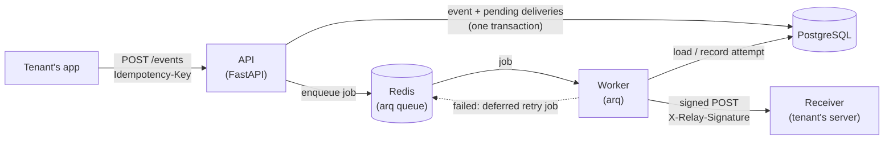

# Relay

**A multi-tenant webhook delivery service.** Tenants register HTTP endpoints and send events to
Relay. Relay delivers each event to every endpoint subscribed to it, signs each request with
HMAC-SHA256 so receivers can verify it, retries failures with exponential backoff and jitter,
and parks deliveries that still fail in a dead-letter state where they can be replayed.
Ingestion is idempotent, so a client can safely retry `POST /events` without creating
duplicates. Built with FastAPI, PostgreSQL, Redis (arq), and Docker. In a k6 load test on a
laptop it ingested **~490 events/s** with a **p95 of 97 ms** and **0 errors**, and every one of
the 44,379 deliveries succeeded.

## Architecture



- **API** accepts events, stores them, enqueues one job per delivery, and responds in
  milliseconds. It never calls receivers itself.
- **Worker** takes jobs off the queue, sends signed HTTP requests, records every attempt, and
  schedules retries. Run more of them to deliver faster (see the load test).
- **PostgreSQL** is the source of truth: tenants, endpoints, events, and every delivery attempt.
- **Redis** holds the job queue, including deferred jobs for future retries.
- **receiver/** is a mock tenant server for local testing. It verifies signatures and can fail
  a chosen percentage of requests (`FAIL_RATE`).

## Quickstart

Needs Docker (with Compose) and `jq`. [uv](https://docs.astral.sh/uv/) is only needed for the
tests, and [k6](https://k6.io/) for the load test.

```bash
git clone https://github.com/cellobeans/relay.git && cd relay

# 1. Config: copy the example and fill in random secrets
cp .env.example .env
sed -i.bak "s/change-me-too/$(openssl rand -hex 32)/; s/change-me/$(openssl rand -hex 16)/g" .env && rm .env.bak

# 2. Start everything and create the database tables
docker compose up --build -d --wait
docker compose exec api alembic upgrade head
curl localhost:8000/healthz        # {"status":"ok","database":"ok","redis":"ok"}

# 3. Create a demo tenant + an endpoint that points at the mock receiver
./scripts/demo_setup.sh
source .demo.env                   # sets RELAY_API_KEY

# 4. Send an event and watch it get delivered
curl -X POST localhost:8000/events \
  -H "Authorization: Bearer $RELAY_API_KEY" -H "Idempotency-Key: order-1" \
  -H "Content-Type: application/json" \
  -d '{"type":"order.created","payload":{"order_id":1}}'
docker compose logs receiver | grep verified
```

Interactive API docs are at <http://localhost:8000/docs>.

## API by example

```bash
# Admin: create a tenant. The API key is shown once; Relay stores only its SHA-256 hash.
ADMIN_TOKEN=$(grep '^ADMIN_TOKEN=' .env | cut -d= -f2)
curl -X POST localhost:8000/admin/tenants \
  -H "Authorization: Bearer $ADMIN_TOKEN" -H "Content-Type: application/json" \
  -d '{"name":"Acme"}'
# -> {"id":"…","name":"Acme","api_key":"rly_…","created_at":"…"}

# Register an endpoint. The signing secret is returned once, here.
curl -X POST localhost:8000/endpoints \
  -H "Authorization: Bearer $RELAY_API_KEY" -H "Content-Type: application/json" \
  -d '{"url":"https://example.com/webhooks","event_types":["order.created","order.paid"]}'
# -> {"id":"…","url":"…","event_types":[…],"active":true,"secret":"whsec_…", …}

curl localhost:8000/endpoints -H "Authorization: Bearer $RELAY_API_KEY"                       # list
curl localhost:8000/endpoints/$ENDPOINT_ID -H "Authorization: Bearer $RELAY_API_KEY"          # get
curl -X POST localhost:8000/endpoints/$ENDPOINT_ID/deactivate -H "Authorization: Bearer $RELAY_API_KEY"

# Send an event. 201 the first time; 200 with the original event for a repeated key.
curl -X POST localhost:8000/events \
  -H "Authorization: Bearer $RELAY_API_KEY" -H "Idempotency-Key: order-1001" \
  -H "Content-Type: application/json" \
  -d '{"type":"order.created","payload":{"order_id":1001}}'

# See an event and every delivery attempt (status, response code, latency, next retry time)
curl localhost:8000/events/$EVENT_ID -H "Authorization: Bearer $RELAY_API_KEY"

# Re-send an event to every endpoint whose delivery ended up dead
curl -X POST localhost:8000/events/$EVENT_ID/replay -H "Authorization: Bearer $RELAY_API_KEY"
# -> {"replayed":1}
```

### What a receiver gets

```http
POST /webhooks HTTP/1.1
Content-Type: application/json
X-Relay-Event-Id: 3afadc11-3de6-4702-ab1c-3eff4a86ad83
X-Relay-Event-Type: order.created
X-Relay-Timestamp: 1794285119
X-Relay-Signature: <64 hex characters>

{"order_id":1001}
```

To verify: compute `hex(HMAC_SHA256(secret, "{X-Relay-Timestamp}.{raw body}"))`, compare it to
`X-Relay-Signature` in constant time, and reject timestamps more than 5 minutes old.
`app/services/signing.py` has a reference `verify()`, which `receiver/main.py` uses.

### Try failures and retries

```bash
# Retry after 1-4 seconds instead of 5s-10m, and make the receiver fail half of all requests
RETRY_DELAYS='[1,2,3,4]' FAIL_RATE=50 docker compose up -d
# … post some events, then GET /events/{id}: you'll see failed attempts followed by a success.
# With FAIL_RATE=100, deliveries go to "dead" after 5 attempts; fix the receiver and replay.
```

## Design decisions

**Idempotency is enforced by the database, not by application code.** `events` has a unique
constraint on `(tenant_id, idempotency_key)`, and ingestion uses
`INSERT … ON CONFLICT DO NOTHING RETURNING id`. Checking "does this key exist?" in Python
and then inserting has a race: two concurrent requests can both see "no" and both insert.
With the constraint, Postgres serialises them, so one wins and the other gets the original
event back (200). A test fires 10 concurrent requests with one key and checks that exactly one
event is created. The event and its delivery rows commit in one transaction, so there's never
an event without its deliveries.

**HMAC signatures with a timestamp.** Each endpoint has its own secret. The signature covers
`"{timestamp}.{body}"`, so it proves the request came from Relay and that neither the body
nor the timestamp was changed. Because the timestamp is signed, receivers can safely reject
requests older than 5 minutes, which stops an attacker from recording a real webhook and
replaying it later. Signatures are compared with `hmac.compare_digest` so response timing
doesn't leak how much of a guess was right.

**Exponential backoff with jitter, and a dead-letter state.** Retryable failures (timeouts,
connection errors, 5xx, 429) are retried after roughly 5s, 30s, 2m and 10m, for 5 attempts in
all. Each delay is randomised by ±20%. Without jitter, every delivery that failed during
the same outage would retry at the same instant and hit the recovering receiver all at once
(a "thundering herd"). Other 4xx responses mean the request itself is rejected, so they aren't
retried. After the last attempt a delivery is `dead`, and `POST /events/{id}/replay` sends it
again (one more attempt) once the receiver is fixed. The retry policy lives in
`app/services/backoff.py` as pure functions, so it's unit tested without a clock or network.
Every attempt is its own row, so the full history is kept.

**At-least-once delivery.** Relay guarantees every event is delivered, but possibly more than
once. Exactly-once isn't achievable over a network: if a receiver processes a request and its
`200` is lost, Relay can't tell that apart from a failure and has to retry. So receivers should
de-duplicate on `X-Relay-Event-Id`, which stays the same across retries. Relay keeps
duplicates rare. Jobs have deterministic IDs (`delivery:{attempt_id}`), so enqueueing twice is a
no-op, and the worker skips any attempt that's no longer `pending`.

**Why arq.** arq is a small asyncio job queue on Redis. It suits a service whose work is mostly
waiting on the network: one worker process runs 50 deliveries at once. It supports
deferred jobs (used for retry delays), cron jobs, and job IDs for de-duplication. Its
at-least-once semantics are what we want: a job stays in the queue until it finishes, so if a
worker crashes mid-delivery the job runs again. Celery would also work but brings far more
machinery than this needs.

**Other choices.**
- **API keys are stored as SHA-256 hashes.** A leaked database doesn't leak working keys. A fast
  hash is fine (unlike for passwords) because the keys are 256 random bits, so there's nothing
  to brute-force. The unique index on the hash makes the lookup on every request one indexed
  query.
- **Tenant isolation is in every query** (`WHERE id = … AND tenant_id = …`). Another tenant's
  resource returns 404, not 403, so its existence isn't revealed.
- **The API enqueues only after its transaction commits**, so a worker never picks up a job for
  a row it can't see yet. If Redis is unreachable at that moment, the row stays `pending`. A
  once-a-minute sweep in the worker re-enqueues overdue pending attempts, using a partial
  index on `status = 'pending'` so it stays cheap as the table grows.
- **The worker doesn't hold a database connection during the HTTP call**, so 50 slow
  receivers can't use up the connection pool.
- **Schema changes only go through Alembic migrations.** The test suite builds its database by
  running them, so the migrations are tested too.

## Load test results

`loadtest/ingest.js` ramps from 0 to 50 virtual users over 90 seconds, each sending
`POST /events` back-to-back with no pauses. Every event matches one endpoint, so it also
creates one delivery to the mock receiver. `loadtest/run.sh` then waits for all deliveries to
finish and computes delivery latency from `delivery_attempts` (`loadtest/delivery_latency.sql`).
Raw results are in `loadtest/results/`.

**Machine:** Apple M4 MacBook (10 cores: 4 performance + 6 efficiency, 16 GB RAM), macOS 27.2.
Docker Desktop VM with 10 CPUs and 7.7 GB RAM. Everything (k6, API, workers, Postgres, Redis,
receiver) runs on that one machine. One API process (single uvicorn worker), stock Postgres
and Redis settings.

| Metric | 1 worker | 3 workers |
|---|---:|---:|
| Events ingested in 90 s | 44,379 | 35,428 |
| Ingest throughput (avg / peak per second) | 493 / 602 events/s | 394 / 518 events/s |
| Ingest latency p50 / p95 / p99 | 40 / 97 / 108 ms | 49 / 133 / 157 ms |
| Ingest error rate | 0.00% | 0.00% |
| Deliveries succeeded | 44,379 / 44,379 | 35,428 / 35,428 |
| Delivery throughput (peak per second) | 511 deliveries/s | 517 deliveries/s |
| **End-to-end delivery p50 / p95 / p99** | **6,781 / 10,852 / 11,394 ms** | **276 / 373 / 398 ms** |
| Worker → receiver HTTP p95 | 1 ms | 2 ms |

*End-to-end delivery latency* is from the API accepting the event to the receiver answering
`2xx`, including time spent waiting in the queue.

**What this shows.** With one worker, the API accepted events (up to ~600/s) faster than one
worker delivered them (~460–510/s), so a queue built up and events waited ~11 s. The HTTP call
itself took about 1 ms, so the delay was all queueing. With three workers the queue never built
up and p95 end-to-end latency fell to 373 ms. That's the payoff of keeping the API and the
worker separate: each scales on its own. Ingest got slower in the 3-worker run because every
process shares one laptop's CPUs and one Postgres. On separate machines that tradeoff wouldn't
apply in the same way.

To reproduce: `./loadtest/run.sh` (or `docker compose up -d --scale worker=3` first).

## Tests

```bash
docker compose up -d postgres redis   # integration tests need a real database and Redis
uv run pytest                         # 51 tests: 24 unit + 27 integration
uv run pytest tests/unit              # unit tests only, nothing needs to be running
```

- **Unit** (`tests/unit/`): signing (reference vector computed with `openssl`, tampered
  body, wrong secret, the 5-minute window) and backoff (which failures retry, schedule, jitter
  bounds).
- **Integration** (`tests/integration/`): run the real app against a real Postgres and Redis,
  using a separate `relay_test` database built from the migrations. They cover auth rejection,
  tenant isolation, idempotent ingestion (including a concurrent race), subscription matching,
  job enqueueing, and end-to-end delivery to a stubbed receiver (an `httpx.MockTransport` that
  verifies signatures). Delivery tests cover success, retryable and non-retryable failures,
  dead-lettering and replay, duplicate job runs, and the stuck-job sweep.

CI (GitHub Actions) runs ruff, the full test suite against Postgres and Redis service
containers, and a Docker image build on every push and pull request.

## Project layout

```
app/
  main.py              FastAPI app, startup/shutdown, router registration
  config.py            settings from environment variables (pydantic-settings)
  db.py                async SQLAlchemy engine + per-request session
  models.py            tables: tenants, endpoints, events, delivery_attempts
  schemas.py           request/response shapes (Pydantic)
  auth.py              API-key and admin-token checks
  routers/             health, tenants (admin), endpoints, events (+ replay)
  services/signing.py  HMAC sign/verify
  services/backoff.py  retry decision and delay schedule
  services/delivery.py send one attempt, record it, schedule retries; stuck-job sweep
  worker.py            arq worker settings and jobs
receiver/main.py       mock receiver (verifies signatures, FAIL_RATE)
migrations/            Alembic migrations
tests/                 unit/ and integration/
loadtest/              k6 script, run script, latency query, results
scripts/demo_setup.sh  creates a demo tenant + endpoint wired to the mock receiver
```

## What's next

- **SSRF protection:** reject endpoint URLs that resolve to private or internal addresses
  (e.g. `http://postgres:5432` or cloud metadata IPs). Right now any URL is accepted, which is
  fine locally but not for a public service.
- **Encrypt endpoint secrets at rest**, and support secret rotation (sign with both old and new
  secrets during a changeover window).
- **Honour `Retry-After`** on 429 and 503 responses instead of always using the fixed schedule.
- **Fairness and back-pressure:** per-endpoint concurrency limits and a circuit breaker, so one
  slow or broken receiver (or one very busy tenant) can't delay everyone else's deliveries.
- **Transactional outbox:** write jobs to a table in the same transaction as the event and have
  a relay process move them to Redis, closing the gap the sweep currently covers.
- **Detect idempotency-key reuse with a different body** (return 422, as Stripe does) instead
  of silently returning the original event.
- **Operations:** Prometheus metrics (queue depth, delivery latency, failure rate by endpoint),
  retention or partitioning for `delivery_attempts`, and running several API processes.
