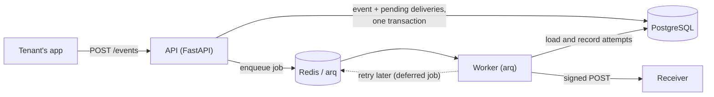
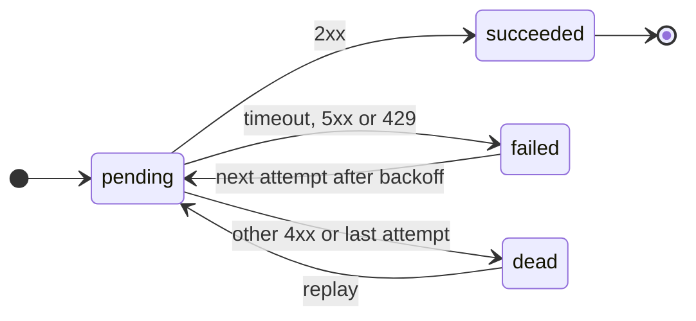

# Relay

[](https://github.com/cellobeans/relay/actions/workflows/ci.yml)

Relay is a webhook delivery service I built to learn backend development properly. Tenants
register HTTP endpoints, send events to Relay, and Relay delivers each event to every endpoint
subscribed to it. Requests are signed with HMAC, failures are retried with exponential backoff,
and deliveries that keep failing end up in a dead-letter state where they can be replayed.

It's modelled on how services like Stripe and GitHub send webhooks, and I focused on the
parts that are easy to get wrong: duplicate events, retries, signature verification and
keeping tenants' data apart.

**Stack:** Python 3.12, FastAPI, PostgreSQL 16 (SQLAlchemy 2.0 async + Alembic), Redis 7 with
arq for background jobs, httpx, pytest, Docker Compose, GitHub Actions, k6.

## What it does

- `POST /events` takes an `Idempotency-Key` header. Sending the same key twice returns the
  original event instead of creating a second one, even if both requests arrive at the same time.
- Each delivery is signed: `X-Relay-Signature` is an HMAC-SHA256 of `"{timestamp}.{body}"`
  using the endpoint's secret, so the receiver can check the request really came from Relay and
  wasn't changed or replayed.
- Timeouts, connection errors, 5xx and 429 are retried after roughly 5s, 30s, 2m and 10m (with
  random jitter). Other 4xx responses aren't retried. After 5 attempts the delivery is marked
  `dead`, and `POST /events/{id}/replay` sends it again.
- Every attempt is stored with its status, response code, latency and error, so you can see
  exactly what happened to an event.
- Each tenant authenticates with its own API key. Only a SHA-256 hash of the key is stored, and
  every query is filtered by tenant.

## Running it locally

You need Docker and `jq`. ([uv](https://docs.astral.sh/uv/) is only needed to run the tests,
and [k6](https://k6.io/) for the load test.)

```bash
git clone https://github.com/cellobeans/relay.git && cd relay

# create .env with random secrets
cp .env.example .env
sed -i.bak "s/change-me-too/$(openssl rand -hex 32)/; s/change-me/$(openssl rand -hex 16)/g" .env && rm .env.bak

# start everything and create the tables
docker compose up --build -d --wait
docker compose exec api alembic upgrade head
curl localhost:8000/healthz

# create a demo tenant with an endpoint pointing at the mock receiver
./scripts/demo_setup.sh && source .demo.env

# send an event, then check the receiver got it
curl -X POST localhost:8000/events \
  -H "Authorization: Bearer $RELAY_API_KEY" -H "Idempotency-Key: order-1" \
  -H "Content-Type: application/json" \
  -d '{"type":"order.created","payload":{"order_id":1}}'
docker compose logs receiver | grep verified
```

The API docs are at http://localhost:8000/docs.

To watch retries happen, make the mock receiver fail half its requests and shorten the delays:

```bash
RETRY_DELAYS='[1,2,3,4]' FAIL_RATE=50 docker compose up -d
```

Then post a few events and look at one with `GET /events/{id}`. You'll see failed attempts
followed by a success. With `FAIL_RATE=100` they end up `dead`. Set it back to 0 and call
`POST /events/{id}/replay`.

## How it works



The API and the worker are separate processes. The API only saves the event, creates one
`pending` delivery row per subscribed endpoint, queues a job for each, and responds. The worker
does the slow part: it sends the HTTP request, records the result, and schedules a retry if it
failed. That way a slow or broken receiver never slows down ingestion, and the worker can be
scaled on its own (the load test below shows why that matters).

Each attempt is its own row, so a delivery's history looks like this:



`receiver/` is a small FastAPI app that acts as a tenant's server for local testing. It
verifies signatures the way a real receiver should, and its `FAIL_RATE` setting makes it fail a
percentage of requests on purpose.

## API

| Method | Path | Auth | |
|---|---|---|---|
| POST | `/admin/tenants` | admin token | Create a tenant. Returns its API key once. |
| POST | `/endpoints` | API key | Register an endpoint. Returns its signing secret once. |
| GET | `/endpoints`, `/endpoints/{id}` | API key | List or get your endpoints. |
| POST | `/endpoints/{id}/deactivate` | API key | Stop delivering to an endpoint. |
| POST | `/events` | API key + `Idempotency-Key` | 201 for a new event, 200 with the original for a repeated key. |
| GET | `/events/{id}` | API key | The event and all its delivery attempts. |
| POST | `/events/{id}/replay` | API key | Re-send to endpoints whose delivery is dead. |
| GET | `/healthz` | none | 200 if Postgres and Redis are reachable, otherwise 503. |

Auth is `Authorization: Bearer <token>`. Asking for another tenant's endpoint or event returns
404, the same as if it didn't exist.

### Verifying a webhook

A receiver gets the event payload as the body, plus these headers:

```
X-Relay-Event-Id: 3afadc11-3de6-4702-ab1c-3eff4a86ad83
X-Relay-Event-Type: order.created
X-Relay-Timestamp: 1794285119
X-Relay-Signature: <hex HMAC-SHA256>
```

Checking it takes a few lines. Use the raw request body, not re-serialised JSON:

```python
import hashlib
import hmac
import time


def verify(secret: str, timestamp: str, raw_body: bytes, signature: str) -> bool:
    if abs(time.time() - int(timestamp)) > 300:  # older than 5 minutes
        return False
    message = f"{timestamp}.".encode() + raw_body
    expected = hmac.new(secret.encode(), message, hashlib.sha256).hexdigest()
    return hmac.compare_digest(expected, signature)
```

Delivery is at-least-once, so receivers should ignore an `X-Relay-Event-Id` they've already
processed.

## Design notes

**Idempotency is enforced by Postgres, not by Python.** There's a unique constraint on
`(tenant_id, idempotency_key)` and the insert is `INSERT ... ON CONFLICT DO NOTHING RETURNING id`.
The obvious approach, checking whether the key exists and then inserting, breaks when two
requests with the same key arrive together: both see "doesn't exist" and both insert. With the
constraint, Postgres makes the second one wait and then do nothing. There's a test that sends
10 concurrent requests with one key and checks only one event exists.

**The timestamp is part of what gets signed.** If it weren't, an attacker could take a real
request they'd captured and resend it later with a new timestamp. Because it's signed,
changing it breaks the signature, so receivers can safely reject anything older than 5 minutes.
Signatures are compared with `hmac.compare_digest`, which takes the same time however many
characters match.

**Retries use jitter.** Each delay is randomised by ±20%. Without that, every delivery that
failed during the same outage would retry at exactly the same moment and could knock the
receiver over again as it comes back. Other 4xx errors aren't retried because sending the same
request again would just get the same rejection. The retry rules are plain functions in
[`app/services/backoff.py`](app/services/backoff.py), which made them easy to unit test.

**Delivery is at-least-once, not exactly-once.** If a receiver handles a request but its
response gets lost, Relay can't tell that apart from a failure, so it has to retry. Exactly-once
isn't possible over a network, so the goal is to never lose an event and keep duplicates rare.
Jobs get a fixed ID based on the attempt (`delivery:{attempt_id}`), so queueing the same one
twice does nothing, and the worker skips any attempt that's already finished. If a worker
crashes mid-delivery, arq runs the job again.

**Why arq.** Deliveries are almost all waiting on the network, so an asyncio-based queue
fits well: one worker process runs up to 50 deliveries at once. arq also has deferred jobs
(which is how retry delays work), cron jobs, and job IDs. Celery would have worked but felt like
much more than this project needed.

Some smaller decisions:

- API keys are hashed with SHA-256 rather than bcrypt. bcrypt is slow on purpose to protect
  guessable passwords, but these keys are 256 random bits, so a fast hash is fine and keeps
  every request quick.
- Jobs are only queued after the database transaction commits, so the worker never gets a job
  for a row it can't see yet. If Redis is down at that exact moment, a sweep that runs every
  minute re-queues any overdue `pending` rows. It uses a partial index on `status = 'pending'`
  so it stays cheap as the table grows.
- The worker releases its database connection before making the HTTP call, so 50 slow
  receivers can't use up the connection pool.
- Every schema change is an Alembic migration. The tests build their database by running the
  migrations, so those get tested as well.

## Load test

[`loadtest/run.sh`](loadtest/run.sh) runs a k6 script that ramps from 0 to 50 virtual users over
90 seconds, each sending `POST /events` as fast as it can. Every event matches one endpoint, so
each one also causes a delivery to the mock receiver. Once everything is delivered, the script
calculates delivery latency from the `delivery_attempts` table
([query](loadtest/delivery_latency.sql)). Raw results are in [`loadtest/results/`](loadtest/results/).

I ran it twice, once with one worker and once with three:

| | 1 worker | 3 workers |
|---|---:|---:|
| Events sent in 90 s | 44,379 | 35,428 |
| Ingest rate, average / peak | 493 / 602 per s | 394 / 518 per s |
| Ingest latency p50 / p95 / p99 | 40 / 97 / 108 ms | 49 / 133 / 157 ms |
| Errors | 0% | 0% |
| Deliveries succeeded | all 44,379 | all 35,428 |
| End-to-end delivery p50 / p95 / p99 | 6.8 / 10.9 / 11.4 s | 276 / 373 / 398 ms |
| Worker to receiver HTTP p95 | 1 ms | 2 ms |

"End-to-end delivery" is the time from the API accepting an event to the receiver answering 2xx.

With one worker, the API was accepting up to about 600 events a second but the worker could
only deliver around 500, so a queue built up and events waited around 11 seconds, even though
each HTTP call took about 1 ms. Adding two more workers fixed it: p95 delivery went from 10.9 s
to 373 ms. Ingest got a bit slower in that run because everything, k6 included, was competing
for the same laptop's CPU and the same Postgres.

Machine: Apple M4 MacBook (10 cores, 16 GB RAM), macOS 27.2, Docker Desktop VM with 10 CPUs and
7.7 GB. One API process, default Postgres and Redis settings. To reproduce, run
`./loadtest/run.sh`, or `docker compose up -d --scale worker=3` first for the second column.

## Tests

```bash
docker compose up -d postgres redis   # the integration tests use a real database and Redis
uv run pytest                         # all 51 tests
uv run pytest tests/unit              # just the unit tests, nothing needs to be running
```

The unit tests cover signing and the retry rules. The signing tests include a reference value I
generated with `openssl`, so they'd catch any change to the signature format.

The integration tests run the real app against Postgres and Redis, in a separate `relay_test`
database that's rebuilt from the migrations on every run. I didn't mock the database because
the things most worth testing, like the unique constraint and the tenant filters, only exist in
Postgres. They cover auth, tenant isolation, idempotency (including concurrent requests), which
endpoints get deliveries, and the full delivery path: success, retries, non-retryable errors,
dead-lettering, replay, a job running twice, and the stuck-job sweep. For delivery tests the
receiver is an `httpx.MockTransport` that checks the signature like a real receiver would.

GitHub Actions runs ruff, the tests (with Postgres and Redis as service containers) and a
Docker build on every push.

## Things I ran into

- **One worker wasn't enough.** I expected delivery to be fast because the receiver answers in
  about a millisecond. In the first load test, events still took 11 seconds to arrive because
  they were waiting in the queue. Scaling the worker separately from the API fixed it, which was
  the clearest demonstration of why they're separate processes.
- **A race in my own setup script.** When I followed the README from a fresh clone, the first
  delivery failed: the demo script restarted the receiver and returned before it was back up.
  Relay retried and delivered it a few seconds later, which is what it's supposed to do, but the
  fix was to make the script wait for the receiver to be healthy.

## What I'd add next

- Block endpoint URLs that point at internal addresses (SSRF). Right now any URL is accepted,
  including things like `http://postgres:5432`, which is fine locally but not on the internet.
- Encrypt endpoint secrets in the database and support rotating them.
- Respect the `Retry-After` header on 429 and 503 responses.
- Per-endpoint limits and a circuit breaker, so one slow receiver or one busy tenant can't hold
  up everyone else.
- Return an error when an idempotency key is reused with a different body, instead of silently
  returning the original event.
- Metrics (queue depth, delivery latency, failures per endpoint) and a cleanup policy for old
  delivery attempts.

## Project layout

```
app/
  main.py            FastAPI app and routers
  config.py          settings from environment variables
  db.py              database engine and session
  models.py          tenants, endpoints, events, delivery_attempts
  schemas.py         request and response models
  auth.py            API key and admin token checks
  worker.py          arq worker: delivery job and stuck-job sweep
  routers/           health, tenants, endpoints, events
  services/
    signing.py       HMAC sign and verify
    backoff.py       retry rules
    delivery.py      sends one attempt, records it, schedules the retry
receiver/            mock receiver
migrations/          Alembic migrations
tests/               unit/ and integration/
loadtest/            k6 script, runner, latency query, results
scripts/             demo setup
```
