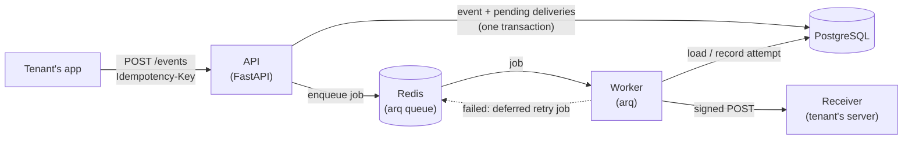
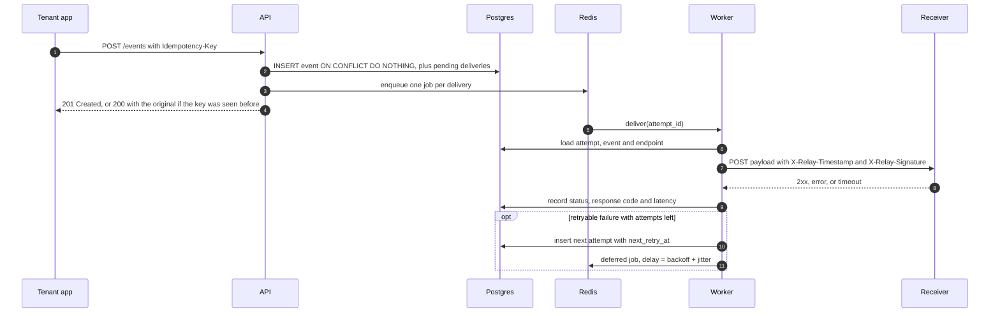
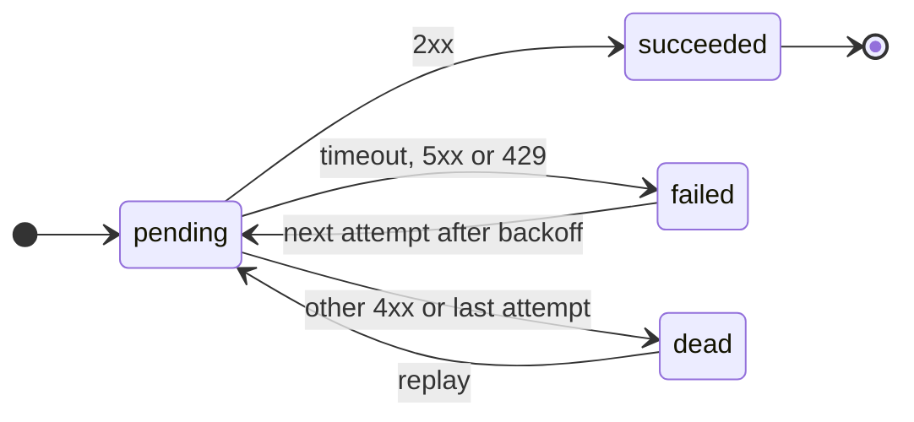

<div align="center">

# Relay

**Reliable, signed webhook delivery for multi-tenant apps.**

Send an event once. Relay delivers it to every subscribed endpoint, signs every request,
retries failures with backoff and jitter, and keeps a full audit trail of each attempt.

[](https://github.com/cellobeans/relay/actions/workflows/ci.yml)


[Quickstart](#quickstart) ·
[How it works](#how-it-works) ·
[API](#api) ·
[Design decisions](#design-decisions) ·
[Load test](#load-test) ·
[Testing](#testing)

</div>

---

## Highlights

| | |
|---|---|
| **~490 events/s** sustained ingest, **p95 97 ms**, **0 errors** | k6, 44,379 events in 90 s on one laptop |
| **373 ms p95** end-to-end delivery with 3 workers | from "event accepted" to "receiver answered 2xx" |
| **Exactly one event** from 20 concurrent requests with the same key | enforced by a Postgres unique constraint |
| **51 tests** against real Postgres and Redis, in CI | unit + integration, no mocked database |

**Features**

- 🔁 **Idempotent ingestion:** retry `POST /events` safely. A repeated `Idempotency-Key` returns
  the original event instead of creating a duplicate.
- ✍️ **Signed deliveries:** HMAC-SHA256 over `timestamp.body`, so receivers can verify that a
  request came from Relay, wasn't modified, and isn't a replay.
- ⏱️ **Retries with exponential backoff and jitter:** 5s → 30s → 2m → 10m. Retries timeouts, 5xx
  and 429, never other 4xx.
- 🪦 **Dead-letter and replay:** after the last attempt a delivery is parked as `dead`. One call
  re-sends it once the receiver is fixed.
- 🏢 **Multi-tenant:** per-tenant API keys (stored only as SHA-256 hashes), and every query is
  scoped to the tenant.
- 🧾 **Full audit trail:** every attempt is a row with status, response code, latency, error,
  and next retry time.
- 🛟 **Self-healing queue:** a periodic sweep re-enqueues deliveries whose job was lost, and a
  worker crash just means the job runs again.

## Quickstart

> Needs **Docker** and **jq**. [uv](https://docs.astral.sh/uv/) is only needed for running tests
> and [k6](https://k6.io/) for the load test.

```bash
git clone https://github.com/cellobeans/relay.git && cd relay

# 1. Config: copy the example and fill in random secrets
cp .env.example .env
sed -i.bak "s/change-me-too/$(openssl rand -hex 32)/; s/change-me/$(openssl rand -hex 16)/g" .env && rm .env.bak

# 2. Start everything and create the tables
docker compose up --build -d --wait
docker compose exec api alembic upgrade head
curl localhost:8000/healthz        # {"status":"ok","database":"ok","redis":"ok"}

# 3. Create a demo tenant with an endpoint that points at the bundled mock receiver
./scripts/demo_setup.sh && source .demo.env

# 4. Send an event and watch it arrive, signature verified
curl -X POST localhost:8000/events \
  -H "Authorization: Bearer $RELAY_API_KEY" -H "Idempotency-Key: order-1" \
  -H "Content-Type: application/json" \
  -d '{"type":"order.created","payload":{"order_id":1}}'
docker compose logs receiver | grep verified
```

Interactive API docs: **<http://localhost:8000/docs>**

<details>
<summary><b>Try failures, retries, dead-letter and replay</b></summary>

```bash
# Retry after 1-4 s instead of 5 s-10 min, and make the receiver fail half of all requests
RETRY_DELAYS='[1,2,3,4]' FAIL_RATE=50 docker compose up -d

# Post a few events, then inspect one: failed attempts followed by a success
curl localhost:8000/events/$EVENT_ID -H "Authorization: Bearer $RELAY_API_KEY"

# Make every request fail: deliveries end up "dead" after 5 attempts
RETRY_DELAYS='[1,2,3,4]' FAIL_RATE=100 docker compose up -d --no-deps receiver

# Fix the receiver, then replay
RETRY_DELAYS='[1,2,3,4]' docker compose up -d --no-deps receiver
curl -X POST localhost:8000/events/$EVENT_ID/replay -H "Authorization: Bearer $RELAY_API_KEY"
# {"replayed":1}
```

</details>

## How it works



| Component | Role |
|---|---|
| **API** | Authenticates, stores the event and its deliveries, enqueues jobs, and responds in milliseconds. Never calls receivers itself. |
| **Worker** | Takes jobs off the queue, sends signed requests, records each attempt, and schedules retries. Scale it on its own. |
| **PostgreSQL** | Source of truth: tenants, endpoints, events, and every delivery attempt. |
| **Redis** | The job queue, including deferred jobs for future retries. |
| **Mock receiver** | Plays a tenant's server locally. Verifies signatures and can fail `FAIL_RATE`% of requests. |

### Life of an event



### Delivery states



Each attempt is its own row: a `failed` attempt is followed by a new `pending` one, so the
whole history stays visible in `GET /events/{id}`.

## API

| Method | Path | Auth | Description |
|---|---|---|---|
| `POST` | `/admin/tenants` | Admin token | Create a tenant. Returns its API key **once**. |
| `POST` | `/endpoints` | API key | Register a URL and the event types it wants. Returns its signing secret **once**. |
| `GET` | `/endpoints` | API key | List your endpoints. |
| `GET` | `/endpoints/{id}` | API key | Get one endpoint. |
| `POST` | `/endpoints/{id}/deactivate` | API key | Stop delivering to an endpoint (history is kept). |
| `POST` | `/events` | API key + `Idempotency-Key` | Ingest an event. `201` if new, `200` with the original if the key was already used. |
| `GET` | `/events/{id}` | API key | The event and every delivery attempt. |
| `POST` | `/events/{id}/replay` | API key | Re-send to every endpoint whose delivery is `dead`. |
| `GET` | `/healthz` | none | `200` if Postgres and Redis are reachable, `503` if not. |

Auth is `Authorization: Bearer <token>`. Another tenant's resources return `404`.

<details>
<summary><b>curl examples</b></summary>

```bash
# Admin: create a tenant (the key is shown once; Relay stores only its SHA-256 hash)
ADMIN_TOKEN=$(grep '^ADMIN_TOKEN=' .env | cut -d= -f2)
curl -X POST localhost:8000/admin/tenants \
  -H "Authorization: Bearer $ADMIN_TOKEN" -H "Content-Type: application/json" \
  -d '{"name":"Acme"}'
# {"id":"…","name":"Acme","api_key":"rly_…","created_at":"…"}

# Register an endpoint
curl -X POST localhost:8000/endpoints \
  -H "Authorization: Bearer $RELAY_API_KEY" -H "Content-Type: application/json" \
  -d '{"url":"https://example.com/webhooks","event_types":["order.created","order.paid"]}'
# {"id":"…","url":"…","event_types":[…],"active":true,"secret":"whsec_…", …}

# Send an event (run it twice: 201, then 200 with the same id)
curl -X POST localhost:8000/events \
  -H "Authorization: Bearer $RELAY_API_KEY" -H "Idempotency-Key: order-1001" \
  -H "Content-Type: application/json" \
  -d '{"type":"order.created","payload":{"order_id":1001}}'

# Inspect deliveries
curl localhost:8000/events/$EVENT_ID -H "Authorization: Bearer $RELAY_API_KEY"
```

</details>

### Receiving webhooks

Every delivery looks like this:

```http
POST /webhooks HTTP/1.1
Content-Type: application/json
X-Relay-Event-Id: 3afadc11-3de6-4702-ab1c-3eff4a86ad83
X-Relay-Event-Type: order.created
X-Relay-Timestamp: 1794285119
X-Relay-Signature: <hex HMAC-SHA256>

{"order_id":1001}
```

To verify one in a receiver, use the **raw** body, not re-serialised JSON:

```python
import hashlib, hmac, time

def verify_relay_webhook(secret: str, headers, raw_body: bytes) -> bool:
    timestamp = headers["X-Relay-Timestamp"]
    if abs(time.time() - int(timestamp)) > 300:  # older than 5 minutes: possible replay
        return False
    expected = hmac.new(secret.encode(), f"{timestamp}.".encode() + raw_body, hashlib.sha256)
    return hmac.compare_digest(expected.hexdigest(), headers["X-Relay-Signature"])
```

Delivery is **at-least-once**, so de-duplicate on `X-Relay-Event-Id`, which is the same on
every retry of an event.

## Design decisions

<details open>
<summary><b>Idempotency is enforced by the database, not application code</b></summary>

`events` has a unique constraint on `(tenant_id, idempotency_key)`, and ingestion runs
`INSERT … ON CONFLICT DO NOTHING RETURNING id`. Checking "does this key exist?" in Python and
then inserting has a race: two concurrent requests can both see "no" and both insert. With the
constraint, Postgres serialises them, so one wins and the other gets the original event back. A
test fires 10 concurrent requests with one key and checks that exactly one event exists. The
event and its delivery rows commit in a single transaction.
</details>

<details>
<summary><b>HMAC signatures that cover the timestamp</b></summary>

Each endpoint has its own secret. The signature covers `"{timestamp}.{body}"`, so it proves the
request came from Relay and that neither the body nor the timestamp was changed. Because the
timestamp can't be forged, receivers can reject anything older than 5 minutes, which stops an
attacker from recording a real webhook and replaying it later. Comparisons use
`hmac.compare_digest`, so response timing doesn't leak how much of a guess was right.
</details>

<details>
<summary><b>Exponential backoff with jitter, then dead-letter</b></summary>

Retryable failures (timeouts, connection errors, 5xx, 429) are retried after roughly 5s, 30s,
2m and 10m, for 5 attempts in all. Each delay is randomised by ±20%. Without jitter, every
delivery that failed during the same outage would retry at the same instant and hit the
recovering receiver all at once (a *thundering herd*). Other 4xx responses mean the request
itself is rejected, so retrying would get the same answer and they aren't retried. After the
last attempt a delivery is `dead` until someone replays it. The policy lives in
[`app/services/backoff.py`](app/services/backoff.py) as pure functions, unit tested without a
clock or network.
</details>

<details>
<summary><b>At-least-once, not exactly-once</b></summary>

Exactly-once isn't achievable over a network: if a receiver processes a request and its `200`
is lost, Relay can't tell that apart from a failure and has to retry. So Relay guarantees
delivery, keeps duplicates rare, and gives receivers a stable `X-Relay-Event-Id` to
de-duplicate on. Jobs have deterministic IDs (`delivery:{attempt_id}`), so enqueueing twice is a
no-op, and the worker skips any attempt that's no longer `pending`.
</details>

<details>
<summary><b>Why arq for the queue</b></summary>

[arq](https://github.com/python-arq/arq) is a small asyncio job queue on Redis, a good fit
for work that's mostly waiting on the network: one worker process runs 50 deliveries at once.
It has deferred jobs (used for retry delays), cron jobs, and job IDs for de-duplication. Its
at-least-once semantics are what we want: a job stays in the queue until it finishes, so a
worker that crashes mid-delivery just means the job runs again. Celery would work too but brings
far more machinery than this needs.
</details>

<details>
<summary><b>Smaller choices</b></summary>

- **API keys are stored as SHA-256 hashes.** A leaked database doesn't leak working keys. A fast
  hash is fine (unlike for passwords) because the keys are 256 random bits, so there's nothing
  to brute-force. A unique index makes the lookup on every request one indexed query.
- **Tenant isolation lives in every query** (`WHERE id = … AND tenant_id = …`). Other tenants'
  resources return 404, not 403, so their existence isn't revealed.
- **Jobs are enqueued after the transaction commits**, so a worker never sees a job for a row
  that doesn't exist yet. If Redis is down at that moment, a once-a-minute sweep re-enqueues
  overdue `pending` rows, using a partial index so it stays cheap as the table grows.
- **The worker doesn't hold a database connection during the HTTP call**, so slow receivers
  can't use up the connection pool.
- **Schema changes only go through Alembic migrations.** Tests build their database by running
  them, so the migrations are tested too.
</details>

## Load test

[`loadtest/ingest.js`](loadtest/ingest.js) ramps from 0 to 50 virtual users over 90 seconds,
each sending `POST /events` back-to-back. Every event creates one delivery to the mock
receiver. [`loadtest/run.sh`](loadtest/run.sh) waits for all deliveries to finish, then
measures delivery latency from the `delivery_attempts` table
([`delivery_attempts` query](loadtest/delivery_latency.sql)). Raw output is in
[`loadtest/results/`](loadtest/results/).

| Metric | 1 worker | 3 workers |
|---|---:|---:|
| Events ingested in 90 s | 44,379 | 35,428 |
| Ingest throughput, avg / peak | 493 / 602 per s | 394 / 518 per s |
| Ingest latency p50 / p95 / p99 | 40 / 97 / 108 ms | 49 / 133 / 157 ms |
| Ingest error rate | **0.00%** | **0.00%** |
| Deliveries succeeded | 44,379 / 44,379 | 35,428 / 35,428 |
| Peak delivery throughput | 511 per s | 517 per s |
| **End-to-end delivery p50 / p95 / p99** | 6,781 / 10,852 / 11,394 ms | **276 / 373 / 398 ms** |
| Worker → receiver HTTP p95 | 1 ms | 2 ms |

**Reading the results.** With one worker, the API accepted events (up to ~600/s) faster than
the worker delivered them (~460–510/s). A queue built up and events waited ~11 s, even though
each HTTP call took only ~1 ms. With three workers the queue never built up and p95 delivery
fell to 373 ms. That's the point of keeping the API and the worker separate: each scales on
its own. Ingest dropped in the 3-worker run because every process (k6 included) shares one
laptop's CPUs and one Postgres.

<sub>Apple M4 (10 cores: 4P + 6E, 16 GB), macOS 27.2, Docker Desktop VM with 10 CPUs / 7.7 GB.
One API process (single uvicorn worker), stock Postgres and Redis. Reproduce with
`./loadtest/run.sh`, adding `docker compose up -d --scale worker=3` first for the second column.</sub>

## Testing

```bash
docker compose up -d postgres redis   # integration tests use a real database and Redis
uv run pytest                         # 51 tests: 24 unit + 27 integration
uv run pytest tests/unit              # unit tests only, nothing needs to be running
```

- **Unit** ([`tests/unit/`](tests/unit/)): signing (including a reference vector computed with
  `openssl`, a tampered body, a wrong secret and the 5-minute window) and backoff (which failures
  retry, the schedule, jitter bounds).
- **Integration** ([`tests/integration/`](tests/integration/)): the real app against real
  Postgres and Redis, in a separate `relay_test` database built from the migrations. They cover
  auth rejection, tenant isolation, idempotency (including a concurrent race), subscription
  matching, job enqueueing, and end-to-end delivery to a stubbed receiver that verifies
  signatures: success, retryable vs non-retryable failures, dead-lettering and replay, duplicate
  job runs, and the stuck-job sweep.

[CI](.github/workflows/ci.yml) runs ruff, the full test suite against Postgres and Redis
service containers, and a Docker image build on every push and pull request.

## Project layout

```
app/
├── main.py              FastAPI app, startup/shutdown, routers
├── config.py            settings from environment variables
├── db.py                async SQLAlchemy engine + per-request session
├── models.py            tenants, endpoints, events, delivery_attempts
├── schemas.py           request/response models
├── auth.py              API-key and admin-token checks
├── worker.py            arq worker: delivery job + stuck-job sweep
├── routers/             health · tenants · endpoints · events (+ replay)
└── services/
    ├── signing.py       HMAC sign / verify
    ├── backoff.py       retry decision + delay schedule
    └── delivery.py      send one attempt, record it, schedule the retry
receiver/main.py         mock receiver (verifies signatures, FAIL_RATE)
migrations/              Alembic migrations
tests/                   unit/ · integration/
loadtest/                k6 script, runner, latency query, results
scripts/demo_setup.sh    demo tenant + endpoint wired to the mock receiver
```

## What's next

- **SSRF protection:** reject endpoint URLs that resolve to private or internal addresses
  (e.g. `http://postgres:5432` or cloud metadata IPs). Today any URL is accepted, which is fine
  locally but not for a public service.
- **Encrypt endpoint secrets at rest** and support rotation (sign with old and new secrets
  during a changeover).
- **Honour `Retry-After`** on 429 and 503 instead of always using the fixed schedule.
- **Fairness and back-pressure:** per-endpoint concurrency limits and a circuit breaker, so one
  slow receiver or one very busy tenant can't delay everyone else.
- **Transactional outbox:** write jobs to a table in the same transaction as the event, closing
  the gap the sweep currently covers.
- **Reject idempotency-key reuse with a different body** (`422`, as Stripe does) instead of
  silently returning the original event.
- **Operations:** Prometheus metrics (queue depth, delivery latency, failure rate per endpoint),
  retention or partitioning for `delivery_attempts`, and several API processes.
